<div align="center">

# ♜ ArtifactScan AI

### Digitise heritage artifacts — from photographs to 3D models to checksummed preservation records.

[](https://github.com/nvaltryek-001/artifactscan-/actions/workflows/ci.yml)


[Features](#-features) · [Demo](#-demo) · [Screenshots](#-screenshots) · [Quick start](#-quick-start) · [Architecture](#-architecture) · [API](#-api-reference) · [Testing](#-testing)

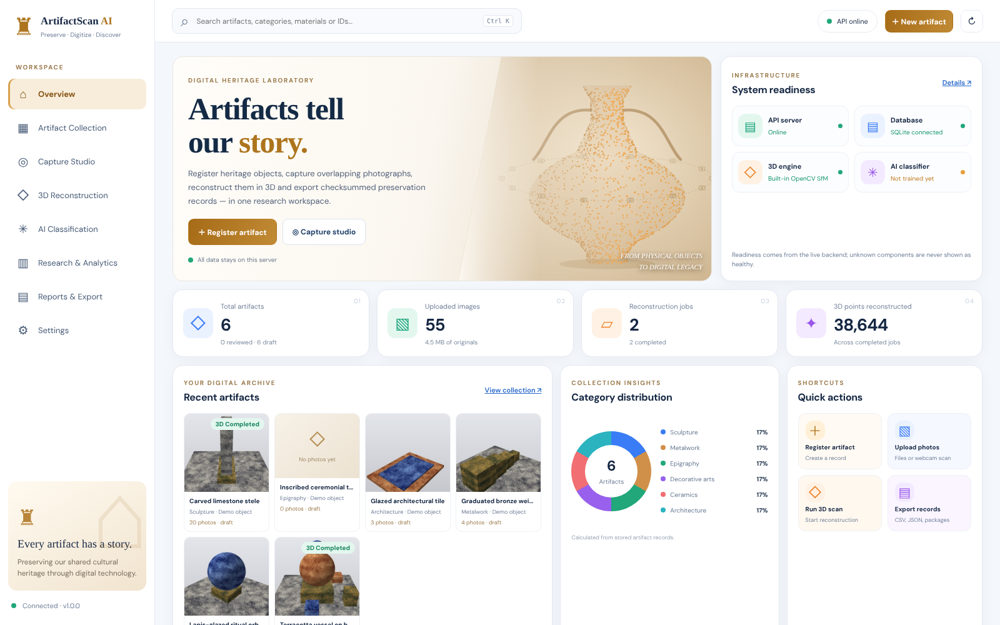

</div>

---

ArtifactScan AI is a self-hosted research workspace for museums, archives, archaeology teams and students. It brings the whole digitisation workflow into one web app:

1. **Catalogue** an object with structured, provenance-aware metadata.
2. **Capture** overlapping photographs — by upload or with an automatic webcam turntable scanner. Each file is validated and SHA-256 checksummed.
3. **Reconstruct** camera poses and a coloured 3D point cloud with Structure-from-Motion (native COLMAP, COLMAP in Docker, or the **built-in OpenCV engine that needs no extra install**).
4. **Inspect** the model in an interactive in-browser 3D viewer.
5. **Classify** with an optional trained model — predictions are stored separately from expert-confirmed labels and are never simulated.
6. **Preserve** everything as a printable digital record or a BagIt-style ZIP with a SHA-256 manifest.

> **Honesty by design.** The app never fakes a result: a job without a valid, finite, parseable PLY is reported as failed; the classifier reports "unavailable" until a real checkpoint exists; reports re-verify checksums at export time.

## ✨ Features

| Area | What you get |
|---|---|
| 🗂️ **Collection** | Searchable, filterable artifact records with 12 metadata fields (period, material, origin, dimensions, provenance, rights, licence…), editable review status (`draft → in_review → reviewed`) and a full audit trail. |
| 📷 **Capture studio** | Drag-and-drop multi-upload with previews, server-side image validation (format, size, decompression-bomb guard), SHA-256 checksums, thumbnails, and an adaptive **webcam auto-scanner** that captures a frame whenever the view changes. |
| 🧊 **3D reconstruction** | Background jobs with a live stage stepper and log. Three interchangeable engines selected automatically: **COLMAP (native) → COLMAP (Docker) → built-in OpenCV SfM** (SIFT, essential-matrix RANSAC, PnP registration, triangulation and sparse bundle adjustment). Outputs are validated before they are published. |
| 👁️ **3D viewer** | Dependency-free canvas point-cloud renderer with a per-pixel depth buffer, orbit/zoom, auto-spin, camera-pose overlay and automatic "up" alignment from the photographer's viewpoints. Reads binary and ASCII PLY. |
| ✳️ **AI classification** | ResNet-18 transfer-learning pipeline on The Met's CC0 iMet subset (`ml/`). Inference averages scores over all of an artifact's photos; predictions need expert review and are never overwritten. |
| 📊 **Analytics** | Category distribution, metadata completeness per field, uploads per day, reconstruction outcomes, plus a reference-dataset explorer. |
| 🏛️ **Preservation** | Catalogue CSV (formula-injection safe) and JSON, per-artifact `record.json`, printable HTML report, and BagIt-style packages with originals, 3D outputs and `manifest-sha256.txt`. |
| 🔒 **Safety** | UUID-validated routes, no filesystem paths in API responses, generated filenames on disk and on the command line, HTML escaping everywhere, optional CORS allow-list, one reconstruction at a time, timeouts. |

## 🎬 Demo

<div align="center">


**[▶ Watch the full-quality demo video (MP4, 64 s)](docs/media/demo.mp4)**
</div>

The demo registers a new artifact, uploads 20 turntable photographs, runs the built-in reconstruction engine (sped up 8× while it runs), orbits the resulting point cloud and opens the preservation exports.

> The objects in the demo and screenshots are **synthetic renders** made with [`scripts/make_sample_images.py`](scripts/make_sample_images.py) so the repository ships with reproducible, licence-free test data. Their records say so in the provenance field. The reconstruction itself is real: 20/20 cameras registered, ~17,700 points, 0.74 px mean reprojection error.

## 🖼️ Screenshots

<table>
  <tr>
    <td width="50%">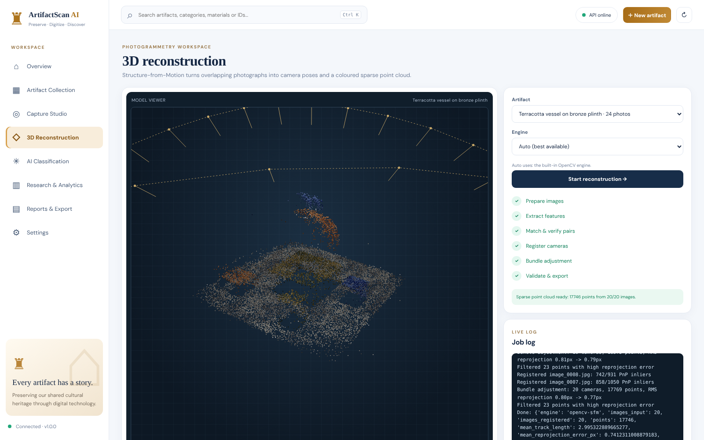<p align="center"><b>3D reconstruction</b> — live stages, job log, interactive point cloud with camera poses</p></td>
    <td width="50%">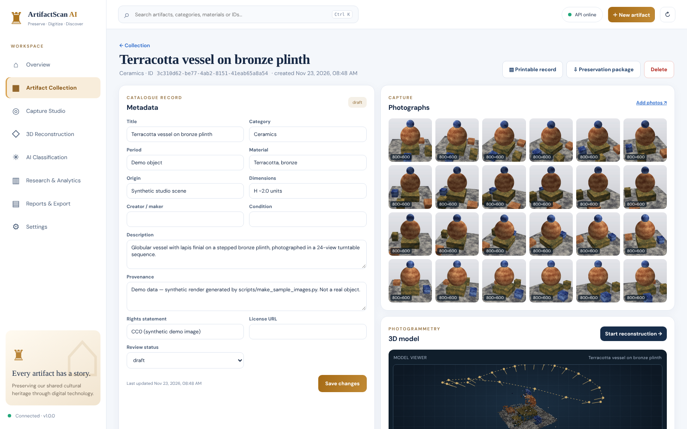<p align="center"><b>Artifact record</b> — metadata, checksummed photographs, 3D model, predictions</p></td>
  </tr>
  <tr>
    <td>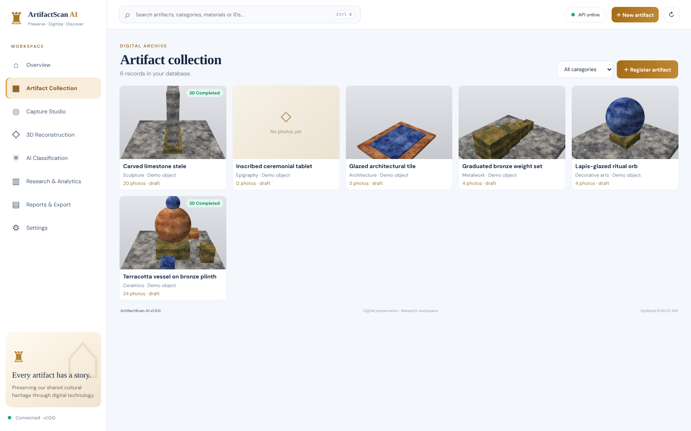<p align="center"><b>Collection</b> — search, category filter, 3D status at a glance</p></td>
    <td>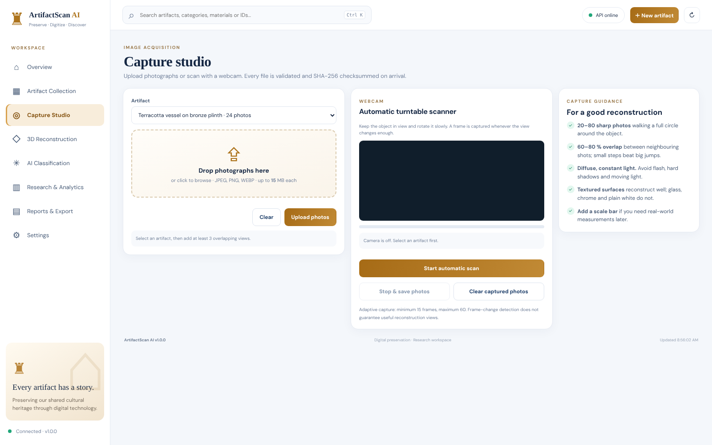<p align="center"><b>Capture studio</b> — drag-and-drop upload and webcam auto-scanner</p></td>
  </tr>
  <tr>
    <td>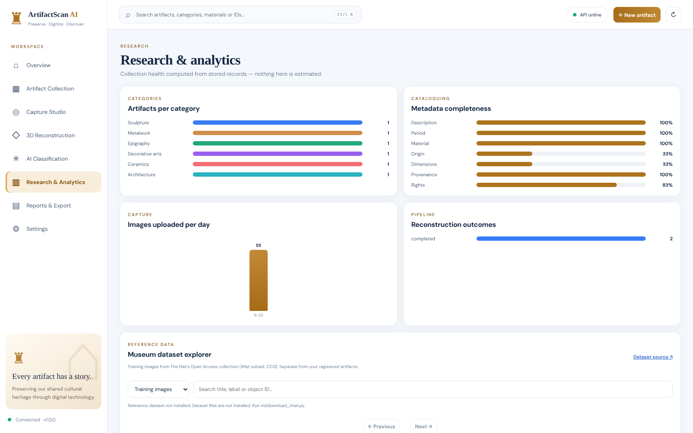<p align="center"><b>Research &amp; analytics</b> — completeness, uploads, outcomes, dataset explorer</p></td>
    <td>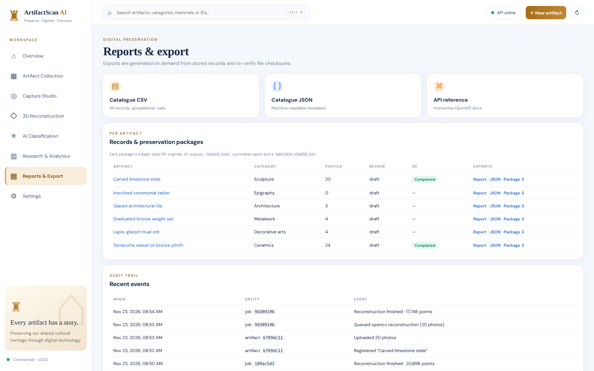<p align="center"><b>Reports &amp; export</b> — CSV/JSON, printable records, BagIt packages, audit trail</p></td>
  </tr>
  <tr>
    <td>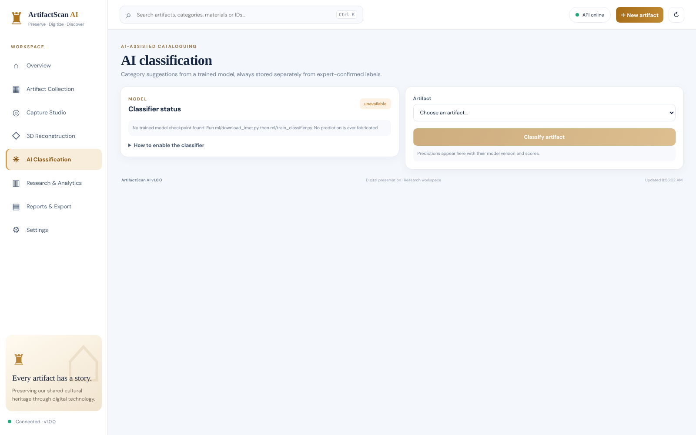<p align="center"><b>AI classification</b> — explicit "unavailable" state until a model is trained</p></td>
    <td>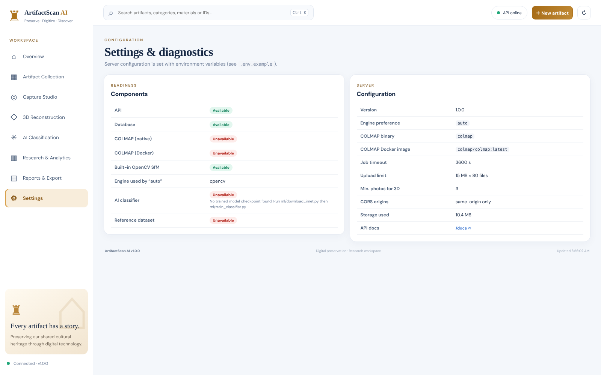<p align="center"><b>Settings</b> — component readiness and server configuration</p></td>
  </tr>
</table>

<details>
<summary><b>📱 Responsive mobile layout</b></summary>
<p align="center">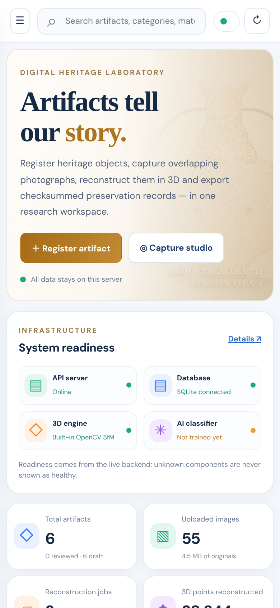</p>
</details>

## 🚀 Quick start

**Requirements:** Python 3.11+ · a modern browser. COLMAP and Docker are optional.

### Windows (PowerShell)

```powershell
git clone https://github.com/nvaltryek-001/artifactscan-.git
cd artifactscan-
.\scripts\setup.ps1        # creates .venv and installs dependencies
.\scripts\run-dev.ps1      # http://127.0.0.1:8000
```

### macOS / Linux

```bash
git clone https://github.com/nvaltryek-001/artifactscan-.git
cd artifactscan-
./scripts/run-dev.sh       # creates .venv on first run → http://127.0.0.1:8000
```

### Docker

```bash
docker compose up --build  # http://localhost:8000 · data persists in the "artifactscan-data" volume
```

Interactive API docs are served at **`/docs`** (Swagger UI) and **`/redoc`**.

### Try it with demo data

With the server running, load six clearly-labelled sample artifacts and reconstruct one of them:

```bash
python scripts/seed_demo.py --reconstruct
```

Or generate your own synthetic turntable set to upload by hand:

```bash
python scripts/make_sample_images.py --out samples/turntable --views 24
```

## 🧊 Reconstruction engines

The engine is chosen per job (`auto` by default):

| Engine | When it is used | Notes |
|---|---|---|
| **COLMAP (native)** | `colmap` is on `PATH` | Best quality. CPU feature extraction/matching, incremental mapper, PLY + TXT export. Handles both the old `SiftExtraction.*` and new `FeatureExtraction.*` option names. |
| **COLMAP (Docker)** | the `colmap/colmap:latest` image is present | Same pipeline inside a container; the job folder is the only mount. |
| **Built-in OpenCV SfM** | always (ships with the app) | [`backend/sfm.py`](backend/sfm.py): SIFT → ratio-test matching → essential-matrix RANSAC → best-baseline initial pair → PnP-RANSAC registration → triangulation with angle/reprojection checks → sparse bundle adjustment (SciPy). Assumes one pinhole camera with focal ≈ 1.2 × image size. |

Every engine writes the same outputs (`sparse_point_cloud.ply`, `cameras.json`, `reconstruction_stats.json`, `job.log`), and every PLY is parsed and checked for finite coordinates before the job is marked complete.

**Capture tips:** 20–80 sharp photos walking a full circle, 60–80 % overlap, diffuse constant light, textured surfaces, and a scale bar if you need real-world measurements.

## 🏗️ Architecture

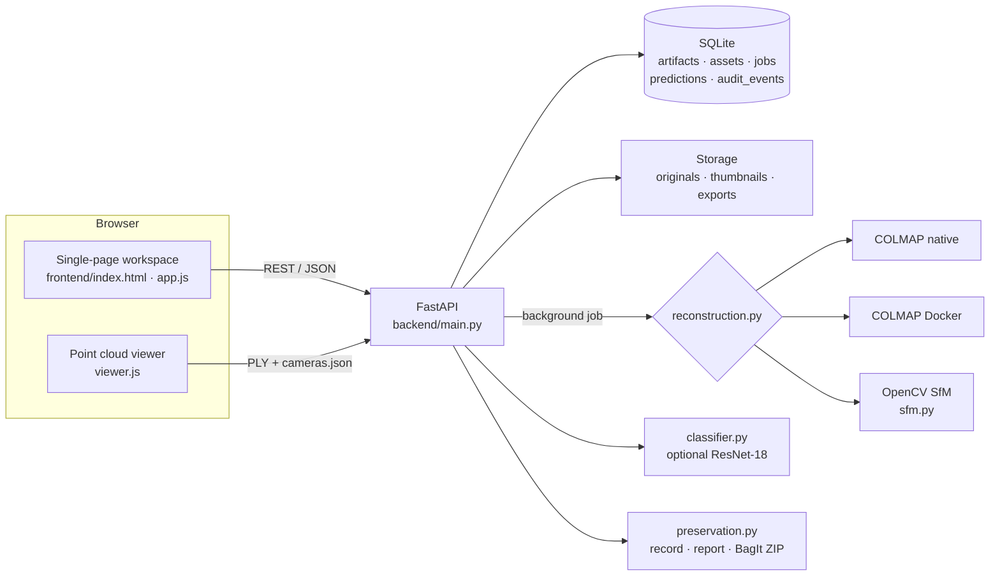

```text
artifactscan-/
├── backend/
│   ├── main.py            # FastAPI app: routes, validation, background jobs
│   ├── config.py          # environment-driven settings
│   ├── db.py              # SQLite schema, in-place migrations, audit events
│   ├── reconstruction.py  # engine selection, COLMAP runner, PLY validation
│   ├── sfm.py             # built-in incremental Structure-from-Motion engine
│   ├── classifier.py      # optional PyTorch inference (never simulated)
│   └── preservation.py    # record.json, HTML report, BagIt-style package
├── frontend/
│   ├── index.html         # all workspace views
│   └── static/            # app.js · viewer.js · styles.css · img/
├── ml/                    # dataset download, verification, classifier training
├── scripts/               # setup/run/test (PowerShell + bash), sample renders, demo seeding
├── tests/                 # API, security and end-to-end reconstruction tests
├── docs/                  # 12 design documents + media/
├── Dockerfile · docker-compose.yml · .github/workflows/ci.yml
└── .env.example
```

## ⚙️ Configuration

All settings are optional environment variables (see [`.env.example`](.env.example)):

| Variable | Default | Purpose |
|---|---|---|
| `ARTIFACTSCAN_STORAGE` | `./storage` | Uploads, thumbnails, reconstructions, exports and the SQLite DB |
| `ARTIFACTSCAN_RECON_ENGINE` | `auto` | `auto`, `colmap`, `docker` or `opencv` |
| `ARTIFACTSCAN_COLMAP_BIN` | `colmap` | Path/name of the native COLMAP executable |
| `ARTIFACTSCAN_COLMAP_IMAGE` | `colmap/colmap:latest` | Docker image for COLMAP |
| `ARTIFACTSCAN_RECON_TIMEOUT` | `3600` | Per-stage timeout in seconds |
| `ARTIFACTSCAN_MAX_UPLOAD_MB` | `15` | Maximum size per image |
| `ARTIFACTSCAN_MAX_FILES` | `80` | Maximum images per upload request |
| `ARTIFACTSCAN_CORS_ORIGINS` | *(empty)* | Comma-separated origins; empty means same-origin only |
| `ARTIFACTSCAN_DATASET` / `ARTIFACTSCAN_MODEL_DIR` | `./data/imet` / `./models/classifier` | Optional ML assets |

## 📡 API reference

| Method | Route | Purpose |
|---|---|---|
| `GET` | `/api/health` · `/api/readiness` · `/api/settings` | Liveness, component availability, configuration |
| `GET` `POST` | `/api/artifacts` | List (search `q`, `category`, pagination) / create records |
| `GET` `PATCH` `DELETE` | `/api/artifacts/{id}` | Detail (assets, jobs, predictions) / partial update / delete with files |
| `GET` `POST` | `/api/artifacts/{id}/images` | List / upload validated, checksummed images |
| `GET` `DELETE` | `/api/artifacts/{id}/images/{asset_id}` | Original or `?thumb=1` thumbnail / remove |
| `POST` | `/api/artifacts/{id}/reconstructions` | Queue a job (`{"engine": "auto"}`) |
| `GET` | `/api/jobs` · `/api/jobs/{id}` · `/api/jobs/{id}/logs` | Job list, status with stats, sanitised log |
| `GET` | `/api/jobs/{id}/model.ply` · `/api/jobs/{id}/cameras.json` | Reconstruction outputs |
| `GET` | `/api/classifier` · `/api/artifacts/{id}/classification` | Model status / latest prediction |
| `POST` | `/api/artifacts/{id}/classifications` · `/api/predictions/{id}/review` | Run inference / store an expert label |
| `GET` | `/api/reports/summary` · `/api/reports/artifacts.csv` · `/api/reports/artifacts.json` | Dashboard metrics and catalogue exports |
| `GET` | `/api/artifacts/{id}/record.json` · `/report` · `/package` | Digital record, printable report, BagIt-style ZIP |
| `GET` | `/api/dataset` · `/api/dataset/images/{split}/{file}` | Reference dataset explorer |

Example:

```bash
ID=$(curl -s -X POST localhost:8000/api/artifacts -H 'Content-Type: application/json' \
      -d '{"title":"Red-figure amphora","category":"Ceramics"}' | jq -r .id)
curl -s -X POST localhost:8000/api/artifacts/$ID/images -F files=@view_000.jpg -F files=@view_001.jpg -F files=@view_002.jpg
curl -s -X POST localhost:8000/api/artifacts/$ID/reconstructions -H 'Content-Type: application/json' -d '{"engine":"auto"}'
```

## ✳️ Training the classifier (optional)

```bash
pip install -r ml/requirements.txt
python ml/download_imet.py        # CC0 images + metadata from The Met's Open Access collection
python ml/verify_dataset.py       # integrity check of the downloaded subset
python ml/train_classifier.py     # ResNet-18 transfer learning → models/classifier/, metrics → logs/
```

Restart the server and the AI Classification page switches from "unavailable" to live inference, showing the training metrics next to every prediction. Scores are uncalibrated and every prediction is stored as `needs_review` until an expert confirms a label.

## 🧪 Testing

```bash
pip install -r requirements-dev.txt
pytest -v
```

The suite (26 tests) runs against an isolated temporary storage directory and covers CRUD and validation, upload rejection and atomic batches, checksum round-trips, path-traversal and invalid-ID handling, CSV formula-injection, HTML escaping in reports, BagIt manifest verification, the "never fabricate a prediction" contract, honest failure on featureless images, PLY validation, and a **full end-to-end reconstruction through the API** that checks registered cameras, point count, reprojection error and recovered camera geometry.

GitHub Actions runs linting, the tests on Python 3.11 and 3.12, a frontend syntax check, and a Docker build with a container smoke test.

## 🗺️ Roadmap

- [ ] Dense reconstruction and meshing (COLMAP `patch_match_stereo` / Poisson) with GLB export
- [ ] Scale-bar detection for metric measurements
- [ ] Authentication and per-user collections; PostgreSQL option for multi-user deployments
- [ ] Persistent job queue (e.g. RQ/Celery) for multi-worker servers
- [ ] IIIF image and Dublin Core / LIDO metadata exports

## ⚠️ Limitations

- Reconstructions are **sparse point clouds**; scale is arbitrary unless a reference object is captured.
- The built-in engine assumes a single uncalibrated camera; for publication-grade results use COLMAP.
- Reflective, transparent and featureless surfaces reconstruct poorly with any photogrammetry tool.
- A checksum proves file integrity, not authenticity or historical correctness; AI labels are not provenance.
- The current build is a single-user local workspace without authentication — do not expose it to the internet as-is.

## 📚 Design documents

Twelve design documents in [`docs/`](docs) cover the vision, system architecture, user flows, application structure, UI/UX, dataset licensing, the photo-to-3D pipeline, AI classification, database and API, digital preservation, testing and security, and deployment.

## 🤝 Contributing

Issues and pull requests are welcome. Please run `pytest` and `ruff check backend tests` before opening a PR, and keep the project's rule: **never present a simulated result as a real one.**

## 📄 License

No licence has been chosen for this repository yet, so all rights are reserved by the author by default. Add a `LICENSE` file (for example MIT or Apache-2.0) to let others use and contribute to the code. The iMet dataset used for training is CC0 (The Metropolitan Museum of Art Open Access).
