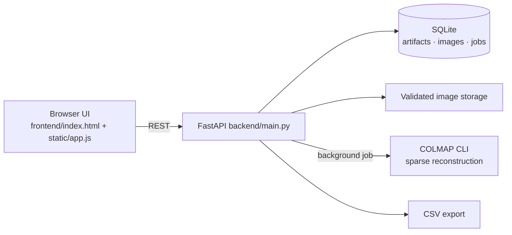

# 🏺 ArtifactScan AI

**Digitise museum and heritage artifacts: structured records with provenance, validated photo uploads, photo-to-3D reconstruction jobs (COLMAP) and CSV exports, all behind a FastAPI backend.**

   

## Architecture



## API

| Method | Route | Purpose |
|---|---|---|
| GET | `/api/health`, `/api/readiness` | Liveness; checks whether COLMAP is available |
| GET/POST | `/api/artifacts` | List / create artifact records with provenance fields |
| GET | `/api/artifacts/{id}` | Artifact detail |
| POST | `/api/artifacts/{id}/images` | Upload validated images |
| POST | `/api/artifacts/{id}/reconstructions` | Start a COLMAP reconstruction job |
| GET | `/api/jobs/{job_id}` | Job status |
| GET | `/api/artifacts/{id}/classification` | Classifier status (disabled until trained) |
| GET | `/api/reports/artifacts.csv` | CSV export |
| GET | `/api/dataset`, `/api/dataset/images/{split}/{file}` | Browse the training dataset |

## Design docs

Twelve design documents in [`docs/`](docs): vision, system architecture, user flows, application structure, UI/UX, dataset licensing, photo-to-3D pipeline, AI classification, database and API, digital preservation, testing and security, and deployment roadmap.

## Requirements
Python compatible with FastAPI, Pillow and the selected dependencies.
Photogrammetry requires a separately installed and verified COLMAP executable.

## Windows setup
```powershell
python -m venv .venv
.\.venv\Scripts\python.exe -m pip install -r backend\requirements.txt
.\.venv\Scripts\python.exe -m uvicorn backend.main:app --host 127.0.0.1 --port 8000
```

Open http://127.0.0.1:8000

## Tests
```powershell
.\.venv\Scripts\python.exe -m pytest tests -q
```

## Current limitations
The classifier is not trained or enabled. The UI does not claim otherwise.
COLMAP must be installed separately. Reconstruction outputs require quality
inspection; a successful process alone does not establish scientific accuracy.
The MVP does not yet provide production authentication or multi-user isolation.