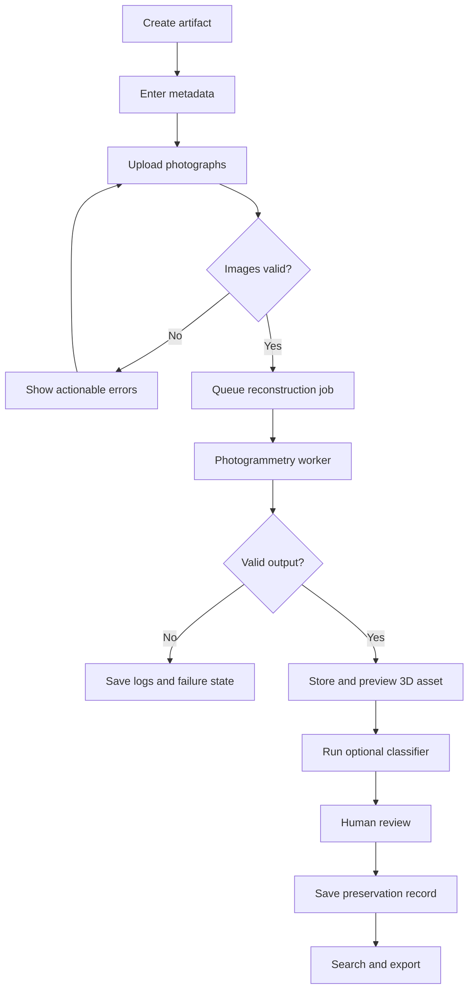

# User Flows and Process Diagrams

## Main workflow
1. Open dashboard.
2. Create a new artifact record.
3. Enter title, category, source, rights and notes.
4. Upload multiple photographs.
5. Validate file types, sizes and image quality.
6. Review capture guidance and start reconstruction.
7. Monitor the background job and inspect errors if it fails.
8. Validate generated geometry and textures.
9. Preview and download the resulting model.
10. Run classification if a compatible trained model is available.
11. Review predicted class and confidence; correct it if necessary.
12. Save metadata, provenance and review history.
13. Search the catalogue and export a report.

## Mermaid — end-to-end flow

## Job state flow
queued -> running -> succeeded
queued -> cancelled
running -> failed
running -> cancelled, only if cancellation is supported
failed -> queued again, using an explicit retry action

## Alternative flows
- Invalid file: reject before processing and explain why.
- Insufficient image overlap: request more photographs.
- Reconstruction tool missing: report setup requirements; do not simulate success.
- Model not installed: mark classification unavailable.
- Low-confidence prediction: request human review.
- Duplicate submission: use a job or request identifier to prevent accidental duplicate work.
- Worker crash: preserve diagnostic logs and recover stale jobs safely.

## UX principles
Show progress and next actions. Do not use a progress percentage unless it comes from measured stages. Keep error messages understandable, while retaining technical logs for troubleshooting.